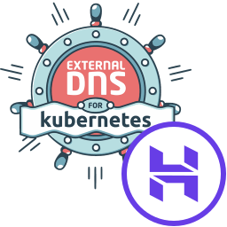

<p align="center">
  
</p>

# external-dns-hostinger-webhook

[](https://github.com/taha2samy-3/external-dns-Hostinger/actions/workflows/ci.yml)
[](https://slsa.dev)
[](https://scorecard.dev/viewer/?uri=github.com/taha2samy-3/external-dns-Hostinger)

An [ExternalDNS](https://github.com/kubernetes-sigs/external-dns)
[webhook provider](https://kubernetes-sigs.github.io/external-dns/latest/docs/tutorials/webhook-provider/)
for domains hosted on [Hostinger DNS](https://www.hostinger.com). ExternalDNS
creates, updates and deletes DNS records for your `Service`, `Ingress` and
Gateway API resources through the [Hostinger API](https://developers.hostinger.com).

- Runs as a sidecar of ExternalDNS and listens on `localhost` only.
- Uses ExternalDNS' own webhook handlers, so the wire format matches ExternalDNS.
- Discovers zones from your Hostinger domain portfolio, or uses `DOMAIN_FILTER`.
- Supports `A`, `AAAA`, `CNAME`, `TXT`, `MX`, `SRV`, `NS` and `CAA` records.
- Tested end to end against ExternalDNS' controller, TXT registry and webhook client,
  and on kind with the official ExternalDNS chart.
- Hardened, non-root, read-only image built on
  [Wolfi-based hardened Go images](https://taha2samy-3.github.io/node/).
- Images are signed and ship SLSA Build Level 3 provenance and an SBOM.

> This is a community project, not affiliated with or endorsed by Hostinger or
> the ExternalDNS project. Logos belong to their respective owners.

## Requirements

- Kubernetes 1.27+
- ExternalDNS 0.15+ (Helm chart 1.15+)
- A Hostinger API token: hPanel → Profile → **API**

## Install

1. Store the API token:

   ```sh
   kubectl create namespace external-dns
   kubectl -n external-dns create secret generic hostinger-credentials \
     --from-literal=api-token='<HOSTINGER_API_TOKEN>'
   ```

2. Install ExternalDNS with the webhook as a sidecar. Each
   [release](https://github.com/taha2samy-3/external-dns-Hostinger/releases) ships an
   `external-dns-values.yaml` with the image pinned by digest; it is
   [deploy/external-dns-values.yaml](deploy/external-dns-values.yaml) with the release image filled in.
   Set your zones and `txtOwnerId` in it, then:

   ```sh
   helm repo add external-dns https://kubernetes-sigs.github.io/external-dns/
   helm upgrade --install external-dns external-dns/external-dns \
     --namespace external-dns -f deploy/external-dns-values.yaml
   ```

### Apex records need a TXT prefix

ExternalDNS' TXT registry names its ownership record `a-example.com` for an
`A` record at `example.com`. That name lies outside the zone, so ExternalDNS
can create apex records but never update or delete them. Set a prefix that
contains the record type and ends in a dot, as the
[ExternalDNS docs](https://kubernetes-sigs.github.io/external-dns/latest/docs/registry/txt/)
recommend:

```yaml
txtPrefix: "extdns-%{record_type}."
```

## Configuration

The webhook is configured through environment variables.

| Variable | Default | Description |
|---|---|---|
| `HOSTINGER_API_TOKEN` | *(required)* | Hostinger API token. |
| `DOMAIN_FILTER` | *(all active domains)* | Comma-separated zones to manage. |
| `DEFAULT_TTL` | `3600` | TTL for records that do not set one. |
| `DRY_RUN` | `false` | Log changes instead of applying them. |
| `REQUEST_TIMEOUT` | `12s` | Deadline for each call from ExternalDNS. Keep it below ExternalDNS' `--webhook-provider-read-timeout` + `--webhook-provider-write-timeout` (15s by default). |
| `ZONE_REFRESH_INTERVAL` | `1h` | How often the domain portfolio is re-read when `DOMAIN_FILTER` is unset. |
| `WEBHOOK_ADDR` | `127.0.0.1:8888` | Listen address of the webhook API. |
| `HEALTH_ADDR` | `0.0.0.0:8080` | Listen address of `/healthz`. |
| `MAX_BODY_SIZE` | `33554432` | Maximum request body size in bytes. |
| `LOG_LEVEL` | `info` | `debug`, `info`, `warn` or `error`. |
| `LOG_FORMAT` | `json` | `json` or `text`. |
| `HOSTINGER_API_URL` | `https://developers.hostinger.com` | API endpoint, for testing. |

ExternalDNS reads the zone list once, at startup. Restart ExternalDNS after
adding a domain to your Hostinger account.

## How records are mapped

Hostinger stores records as sets keyed by name and type, the same unit as an
ExternalDNS endpoint. Creates and updates replace the whole set
(`PUT /api/dns/v1/zones/{domain}` with `overwrite: true`) and deletes remove it.
Deletes are applied before creates, so a record can change type in one sync.

- Host names in `CNAME`, `NS`, `MX` and `SRV` content are sent fully qualified
  (`target.example.net.`) and returned without the trailing dot.
- `TXT` values are sent unquoted. Hostinger returns them quoted, which is the
  form ExternalDNS uses.
- `SOA` and Hostinger's `ALIAS` records are never reported to ExternalDNS, so they
  are never changed.
- Set identifiers (weighted or geo routing) are not supported.

No separate Helm chart is needed: the webhook runs inside the official
ExternalDNS chart (`provider.webhook`), which provides the Deployment, RBAC and probes.

## Verify the image

```sh
gh attestation verify oci://ghcr.io/taha2samy-3/external-dns-hostinger:<version> \
  --owner taha2samy-3 \
  --signer-workflow taha2samy-3/external-dns-Hostinger/.github/workflows/build-image.yml
cosign verify ghcr.io/taha2samy-3/external-dns-hostinger:<version> \
  --certificate-identity-regexp '^https://github.com/taha2samy-3/external-dns-Hostinger/' \
  --certificate-oidc-issuer https://token.actions.githubusercontent.com
```

## Development

```sh
make test       # unit tests + ExternalDNS sync test against a fake Hostinger API
make build      # binary in _out/webhook
make image      # container image
test/e2e/run.sh # kind + official ExternalDNS chart + fake Hostinger API (needs docker, kind, helm, jq)
```

## Releasing

Push a tag; [release.yml](.github/workflows/release.yml) does the rest:

```sh
git tag -a v0.1.0 -m "Release v0.1.0"
git push origin v0.1.0
```

It runs the full CI (including e2e), builds the multi-arch image, pushes it to
`ghcr.io/taha2samy-3/external-dns-hostinger` (`<version>`, `<major>.<minor>`
and `latest`), signs it with cosign, attests SLSA provenance and an SBOM, scans
it, and creates a GitHub release with the digest-pinned values file. An existing
tag can also be released from the Actions tab (*Release → Run workflow*).

## Automation

- **Dependabot** opens PRs for Go modules, base image digests and actions;
  patch, minor and digest updates are auto-merged once CI is green.
- **Auto release** cuts a patch release every Tuesday when shipped files changed.
- **Upstream watch** opens issues when Hostinger's API or the ExternalDNS chart
  changes, and scans the published image for new vulnerabilities.

## License

[Apache 2.0](LICENSE)
